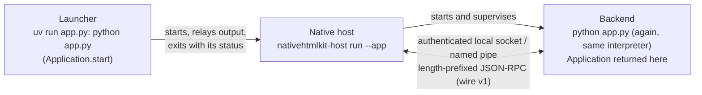
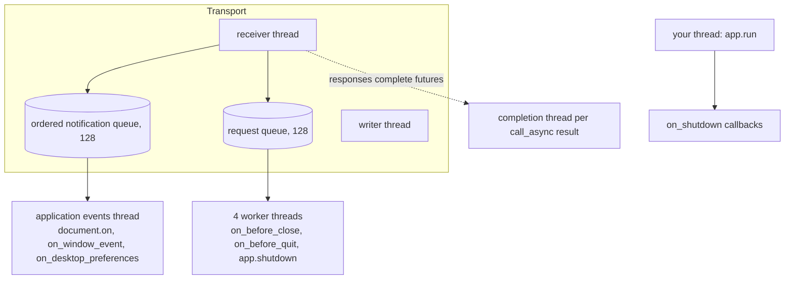
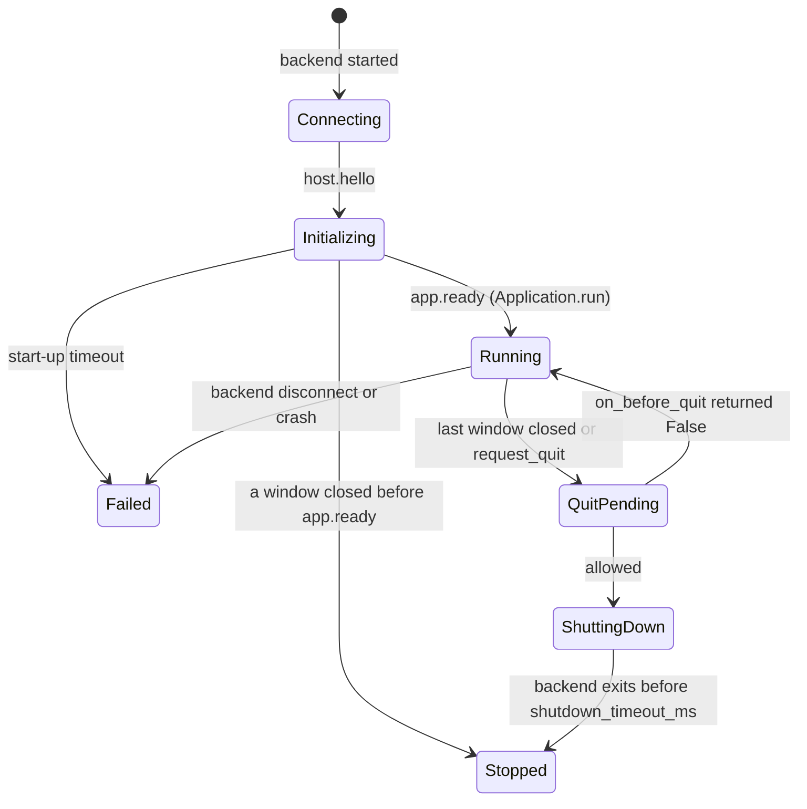

# Python SDK architecture

How `nativehtmlkit` 0.1.2 runs an application: which processes exist, how they find and trust each
other, which threads run your code, and why handles become stale. For the API itself see the
[reference](API.md).

## Process model

Three roles cooperate:

| Process | Owns |
|---|---|
| **Launcher**: the command you ran | Writing a private manifest, starting the host, relaying output, propagating the exit status and signals |
| **Native host** (Rust, bundled in the wheel) | Windows, rendering, input, IME, accessibility, native dialogs and services, the event loop, start-up/shutdown policy, supervising the backend |
| **Backend**: your Python code | Application logic; the `Application`/`Window`/`Document` objects |

There is no browser, JavaScript engine or HTTP server. The backend never draws; it sends commands
and receives events.

## Start-up: re-executing the script

`Application.start()` decides its role from the environment:

1. **No host connection variables:** this is the launcher. It reconstructs the current command
   line from `sys.orig_argv` (interpreter options and `-m module` form preserved; a script path made
   absolute), writes `app.toml` into a fresh private temporary directory (prefix
   `nativehtmlkit-start-`, removed afterwards; leftovers older than a day are swept), resolves and
   verifies the host, and runs `nativehtmlkit-host run --app <manifest>` (plus `--headless` when
   `NATIVEHTMLKIT_TEST_MODE=1`). It marks the environment with `UI4ME_DIRECT_START` so that a
   backend that somehow lacks a connection refuses to start yet another host.
2. **Connection variables present:** this is the backend. `start()` validates the options,
   connects with [`from_environment()`](reference/application.md#applicationfrom_environment-classmethod)
   and returns the `Application`.

Consequently code before `start()` runs in both processes. `uv run -m nativehtmlkit run
module:func` avoids that: its launcher never imports your module, and its backend imports it once,
after connecting.

### Host resolution and verification

`nativehtmlkit.host_binary()` picks the host: `NATIVEHTMLKIT_HOST_BINARY` (explicit development
override), else the wheel's bundled `_bin/nativehtmlkit-host[.exe]`, whose SHA-256 must match
`_bin/HOST-MANIFEST.json` on **every** launch (`HostVerificationError` otherwise), else, only with
`NATIVEHTMLKIT_ALLOW_PATH_HOST=1`, an absolute `PATH` entry (unverified, with a warning).
`uv run nativehtmlkit-python version` reports which one is used and whether the build identity matches.

### Lifetime binding

The host must not outlive the launcher, and the backend must not outlive the host:

- Linux: the host is started with `PR_SET_PDEATHSIG` (SIGTERM if the launcher dies); the host
  runs the backend under its own containment.
- Windows: the host is placed in a kill-on-close Job Object held by the launcher; the host puts
  the backend in its own job.
- Ctrl+C, SIGTERM or SIGHUP to the launcher terminate the host (forcefully after 10 s); the
  launcher exits with 128 + signal number.

### Output relay

The host captures the backend's standard output and error and writes them, with its own
structured records, to its standard error as JSON lines. The launcher turns backend lines back
into plain text on the matching stream, summarises host warnings and errors, and shows host
information records only with `NATIVEHTMLKIT_VERBOSE=1`. The backend runs with
`PYTHONUNBUFFERED=1` and UTF-8 output so `print()` appears at once.

## Connection

- **Transport:** a Unix domain socket in a private runtime directory (Linux) or a named pipe
  restricted to the current logon session (Windows; overlapped I/O so reads and writes do not
  block each other).
- **Authentication:** the first request is `host.hello` with the single-use 64-hex token from
  `UI4ME_TOKEN` and `protocol_version: 1`. The SDK then deletes `UI4ME_ENDPOINT`, `UI4ME_TOKEN`,
  `UI4ME_APP_ID` and `UI4ME_PROTOCOL_VERSION` from `os.environ`.
- **Framing:** 4-byte big-endian length + one UTF-8 JSON object, at most 2 MiB. Outgoing requests
  that cannot be encoded or are too large are refused locally (`LocalRequestError`); a malformed
  frame from the host is fatal (`ProtocolError`).
- **Messages:** a JSON-RPC 2.0 subset. Request ids are strings (`py-1`, `py-2`, …), responses are
  matched by id, never by order. At most 128 requests may be pending and 8 MiB queued for writing
  (`ClientBusyError` beyond that, nothing sent).
- **Deadlines:** synchronous calls default to 15 s (none for native dialogs). A timeout sends
  `request.cancel` and raises `RpcTimeoutError` with `outcome_unknown=True`: the SDK never claims a
  rollback.

## Threads

- The **receiver** reads frames, completes pending requests and sorts host messages into queues.
  The **writer** drains the outgoing queue. Neither ever runs application code, so a callback may
  make blocking SDK calls without deadlocking the connection.
- **Notifications** (`document.event`, `window.event`, `document.error`, preference changes) go to
  one **ordered** queue served by a single *application events* thread: your event callbacks run one
  at a time, in the order the host sent them.
- **Host requests** (`window.before_close`, `app.before_quit`) and `app.shutdown` go to a pool of
  four workers. Close and quit decisions are therefore answered even while an event callback waits,
  for example on a blocking file dialog. Every host request is answered; an exception counts as a
  denial.
- **Futures** from `call_async` (and `wait=False` dialogs) are completed on a short-lived
  completion thread each, so their done-callbacks may call the synchronous SDK.
- Both queues hold 128 messages. When callbacks fall that far behind, further notifications are
  dropped and counted (`rpc.dropped_notifications`); further host requests are answered with
  -32005. The host separately drops window/document events when the backend stops reading its
  socket and reports them in `host.diagnostics` `dropped_notifications`.

All public methods are safe to call from any thread: requests from several threads are multiplexed
over the one connection.

## Callback dispatch

For each `document.event` the application looks up the window and checks that the event's
`document_id` is the window's **current** document; events of a retired document are dropped
silently. The document then matches subscriptions: same `type`, and either no `element` filter or
the filter equals the event's `element` (nearest identified target) or appears in its `path`
(identified bubbling route). Matching handlers run in subscription order; one raising does not stop
the others. Each dispatch writes a `document.dispatch` trace record with the number of registered
and matched handlers.

`window.event` first updates bookkeeping (a `closed` window is marked closed and its document
retired) and then calls `on_window_event` listeners.

## Document generations

Every successful `document.load` returns a new document id. The `Window` swaps its `document`
attribute only after the load succeeded, then retires the previous `Document`:

- its subscriptions are cleared and its live bitmaps closed;
- every method on it, and on `Node`s that reference it, raises `StaleDocumentError` locally;
- the host independently rejects the old id (`RpcError` -32004) if it ever receives it.

Node references (`node:…`) embed the document generation, so they cannot address the replacement
document either. The same retirement happens on `unload()`, on the window's `closed` event, after a
fatal `document.error` and, for everything, on `app.shutdown`.

## Lifecycle state machine

On `app.shutdown` the SDK sets `rpc.shutdown_requested`, waits up to two seconds for already
received events to be handled, records the host's drop counter, retires every window and document,
runs `on_shutdown` callbacks on the thread of `run()`, and `run()` returns. Core v1 sends no
`closed` event for the last window; `app.shutdown` implies it. During shutdown the host refuses
most methods (`RpcError` -32008), so on-shutdown code should only touch Python state and files.

If the connection drops instead, pending requests fail with `DisconnectedError` (their outcome is
unknown) and `run()` raises `DisconnectedError`. A deliberate `close()` ends `run()` normally on the
Python side, but the host sees a lost backend and exits with status 1.

## asyncio layer

`AsyncApplication` adds no second connection. `AsyncRpcClient.call` wraps the transport future with
`asyncio.wrap_future`; `EventDispatcher` moves events from the application events thread onto your
loop with `call_soon_threadsafe` into a bounded FIFO and runs callbacks (sync or async) there one at
a time. `AsyncApplication.run()` runs the blocking `Application.run()` in a worker thread.

## Diagnostics

Each layer records structured, privacy-filtered events: the SDK into memory (and, at debug/trace,
JSON Lines files), the host into its standard error. One session id
(`NATIVEHTMLKIT_DIAGNOSTIC_SESSION_ID`) is shared by launcher, host and backend, and RPC records carry
`cause_seq`, the notification whose callback issued them, so a timeline links "user clicked" to
"handler ran" to "host answered". See [diagnostics](reference/diagnostics.md).

## Packaging

A platform wheel bundles exactly one Core host for its OS (`_bin/`), its `HOST-MANIFEST.json` with
the pinned SHA-256 and build identity, and the Core licence notices; a source-only build has no
host. See [BUILD.md](BUILD.md).

## Boundaries

The SDK speaks only the public Core wire protocol v1; it imports no Core internals. Reusable
components and reactive state are not part of the SDK; a layer for them must use only this SDK's
public API.
