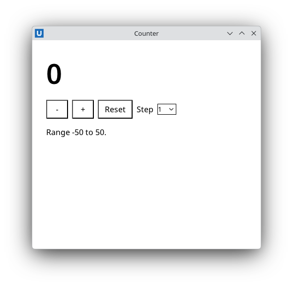
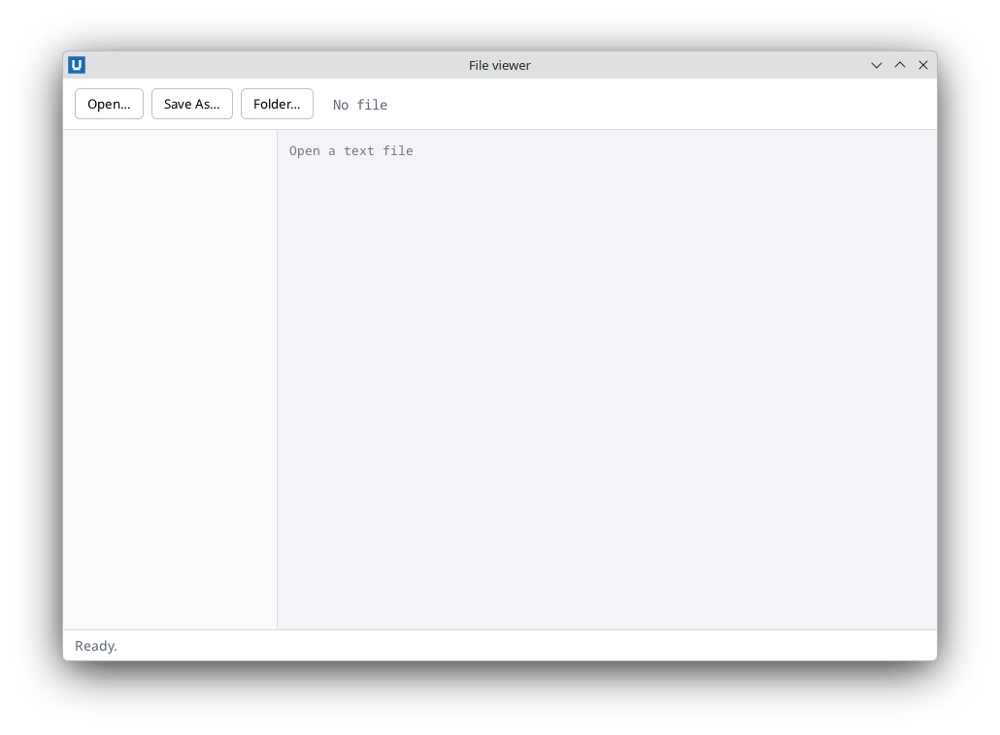
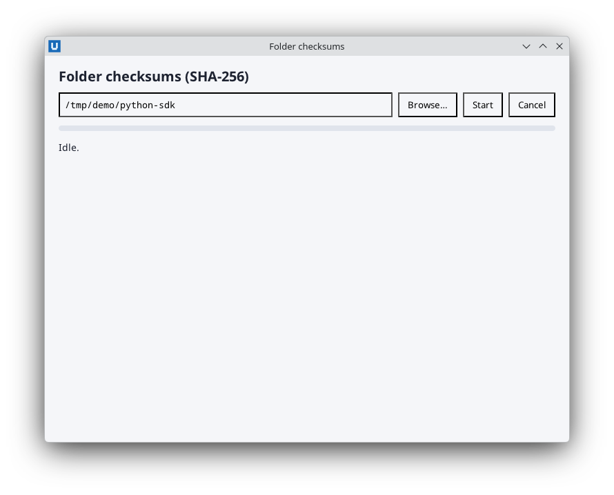
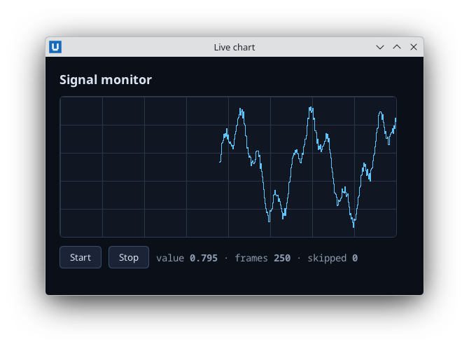
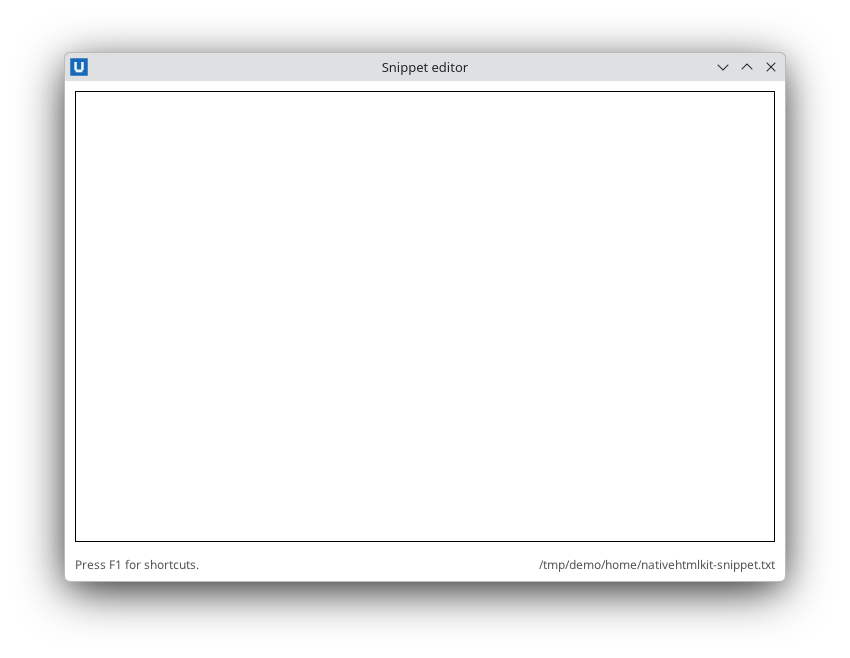
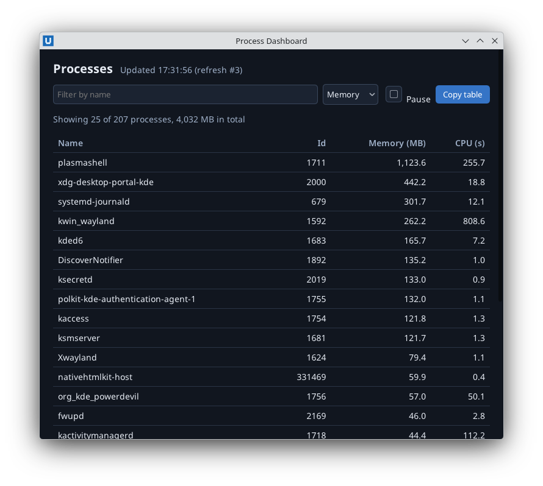

# Python SDK examples

Runnable applications for `nativehtmlkit` 0.1.2. Each file starts with a docstring that says what
it teaches and how to run it; all of them use only the public SDK API and run on Linux and Windows.
[`catalog.toml`](catalog.toml) lists them in machine-readable form; each `id` is shared with the
[PowerShell SDK examples](https://github.com/nativehtmlkit/nativehtmlkit-powershell/tree/main/examples),
which use the same ids for their counterparts.

Run them from a uv project that has the SDK. Copy an example file (or its folder, for
`bulk_rename/` and `process_dashboard/`) into the project and run it:

```bash
uv init --app nhk-examples && cd nhk-examples
uv add nativehtmlkit
cp ../nativehtmlkit-python/examples/todo.py .     # from a clone of this repository
uv run todo.py
```

Running `uv run examples/todo.py` inside a clone of this repository does **not** work: uv would
build the SDK from this source tree, which has no native host.

## Start here

| Example | What it is | What it teaches |
|---|---|---|
| [hello.py](hello.py) | **Hello**: The smallest complete app: a greeting form that writes untrusted text safely. | application lifecycle, get_value, set_text |
| [counter.py](counter.py) | **Counter**: A counter with a step selector, limits and a bounded change history. | shared state, event delegation, batch updates, trim_children |
| [todo.py](todo.py) | **Todo list**: Add, edit, complete, filter and delete tasks, saved to a JSON file. | form submit, delegated list events, escaping user text, keyboard editing, atomic JSON persistence |

## Forms, tables and the DOM

| Example | What it is | What it teaches |
|---|---|---|
| [signup_form.py](signup_form.py) | **Sign-up form**: Sign-up form with native constraint validation, a password-match rule, an error summary and a result. | constraint validation, invalid events, set_custom_validity, form_data, reset_form |
| [data_table.py](data_table.py) | **Inventory data table**: Searchable, sortable, paged table rendered from data, with a details pane. | input/change events, batch updates, rendering rows safely |
| [process_viewer.py](process_viewer.py) | **Process viewer**: Sortable, filterable table of running processes. | rendering data as a table, input event value, sortable headers with aria-sort |
| [dom_explorer.py](dom_explorer.py) | **DOM explorer**: Tree view of a live DOM with selecting, editing, moving and deleting nodes. | Node, query_nodes, children, inspect, move_to, stale nodes |

## Windows, dialogs and files

| Example | What it is | What it teaches |
|---|---|---|
| [window_manager.py](window_manager.py) | **Multiple windows**: Note windows managed from a main window, with a close veto for unsaved notes. | several windows, window state, on_window_event, on_before_close |
| [settings_dialog.py](settings_dialog.py) | **Settings dialog**: Settings in a modal HTML dialog, saved to JSON: colour scheme, text size and reduced motion. | show_dialog/close_dialog, popovers, set_environment, replaceable stylesheet, form validation |
| [file_viewer.py](file_viewer.py) | **File viewer**: Text file viewer and editor with native Open, Save As and Choose Folder dialogs. | open_files/save_file/choose_folder, wait=False futures, file filters, -32001 fallback |
| [bulk_rename/app.py](bulk_rename/app.py) | **Bulk rename**: Rename many files with find/replace, a live preview, a confirmation dialog and undo. | open_file with index.html and style.css, pure planning logic, live preview, folder dialog fallback, undo |

## Keyboard, desktop services and diagnostics

| Example | What it is | What it teaches |
|---|---|---|
| [keyboard_shortcuts.py](keyboard_shortcuts.py) | **Snippet editor**: A snippet editor with keyboard shortcuts, Tab indentation and a help popover. | keydown chords, prevent_default, replace_control_range, control selection |
| [text_toolbox.py](text_toolbox.py) | **Clipboard tool**: Text transforms, copy and paste, a documentation link and the desktop colour scheme. | clipboard, link_activated, open_external, capabilities |
| [diagnostics.py](diagnostics.py) | **About and support**: An About/Support window: capabilities, preferences, counters and a support bundle. | capabilities, desktop_preferences, host_diagnostics, export_support_bundle |

## Background work and live updates

| Example | What it is | What it teaches |
|---|---|---|
| [log_viewer.py](log_viewer.py) | **Log viewer**: Follows a growing log file with highlighting, pause, clear and auto-scroll. | polling in a background thread, appending lines, trim_children, set_scroll_follow |
| [checksum.py](checksum.py) | **Checksums**: SHA-256 of every file in a folder, computed in the background with progress, cancel and a quit warning. | worker thread, throttled progress, cooperative cancel, on_before_quit |
| [async_jobs.py](async_jobs.py) | **Background jobs**: Concurrent jobs with progress bars and cancel buttons. | asyncio tasks, async callbacks, AsyncRpcClient, cancellation |
| [live_chart.py](live_chart.py) | **Live chart**: A live line chart of memory use drawn into an RGBA bitmap. | create_bitmap, RGBA frames, present from a background thread, pause |
| [process_dashboard/dashboard.py](process_dashboard/dashboard.py) | **Process dashboard**: Live process monitor that refreshes in the background, with filter, sort, pause and copy. | background thread, thread-safe updates, pause/resume, clipboard |
| [focus_timer.py](focus_timer.py) | **Focus timer**: A countdown timer that asks before quitting while it runs. | both entry styles, on_before_quit, on_shutdown, request_attention |

## Python-specific

| Example | What it is | What it teaches |
|---|---|---|
| [async_counter.py](async_counter.py) | **Async counter**: A counter whose callback is an async function (asyncio basics). | async_adapter, awaitable document.command |

## Tutorials

- [Build a todo app](../docs/tutorials/todo-app.md) builds `todo.py` in steps; the intermediate
  programs are in [tutorial/](tutorial/):
  [step1_window.py](tutorial/step1_window.py) ·
  [step2_add.py](tutorial/step2_add.py) ·
  [step3_complete_delete.py](tutorial/step3_complete_delete.py) ·
  [step4_edit_keyboard.py](tutorial/step4_edit_keyboard.py).
- [Bulk rename](../docs/tutorials/bulk-rename.md) builds [bulk_rename/](bulk_rename/)
  (`app.py`, `index.html`, `style.css`).
- [Process dashboard](../docs/tutorials/process-dashboard.md) builds
  [process_dashboard/](process_dashboard/) in three programs:
  [step1_snapshot.py](process_dashboard/step1_snapshot.py) ·
  [step2_filter.py](process_dashboard/step2_filter.py) ·
  [dashboard.py](process_dashboard/dashboard.py), with the helper
  [processes.py](process_dashboard/processes.py).

## Two ways to start an example

```bash
uv run focus_timer.py                                  # Application.start()
uv run -m nativehtmlkit run focus_timer:setup    # host-first runner, setup(app)
```

## Without a desktop

Native dialogs, clipboard, opening links and window attention need a desktop session. In
headless mode (`NATIVEHTMLKIT_TEST_MODE=1`) and on systems without those services they fail with
`RpcError` -32001, and the examples show a message instead of crashing.

## How the examples are tested

- `tests/integration/test_examples.py` starts every entry of `catalog.toml` and every tutorial
  step against the real host until the application is ready, stops it and checks that no process
  is left. It fails when a program under `examples/` is missing from the catalogue.
- `tests/integration/test_example_behaviour.py` runs one check per catalogue entry
  (`tests/integration/example_checks.py`): it calls the example's `build(...)` function inside a
  host-supervised backend, drives it through the example's own methods and the public SDK
  (`request_submit`, `set_value`, ...) and reads the DOM back through the public API. It fails when
  an entry has no check.

```bash
NATIVEHTMLKIT_HOST_BINARY=/path/to/nativehtmlkit-host uv run --no-project --with pytest --with pytest-timeout pytest tests/integration
```

Headless mode has no synthetic pointer or keyboard input; clicks, typing and native dialogs are
exercised on a real desktop.

## More

- [Getting started](../docs/getting-started.md), [how-to guides](../docs/guides/README.md) and
  [API reference](../docs/API.md)
- The [public gallery demo](https://github.com/nativehtmlkit/nativehtmlkit/tree/main/examples/python-sdk)

## Screenshots

Real captures on KDE Plasma 6.6 Wayland (100% scaling) with Core 1.0.3 and Python SDK 0.1.2, taken by running each example unchanged. Windows looks the same apart from the window frame.

| | |
|---|---|
| [Hello](hello.py)<br> | [Counter](counter.py)<br> |
| [Todo list](todo.py)<br> | [Sign-up form](signup_form.py)<br> |
| [Inventory data table](data_table.py)<br> | [Process viewer](process_viewer.py)<br> |
| [Log viewer](log_viewer.py)<br> | [File viewer](file_viewer.py)<br> |
| [Multiple windows](window_manager.py)<br> | [Settings dialog](settings_dialog.py)<br> |
| [Clipboard tool](text_toolbox.py)<br> | [Checksums](checksum.py)<br> |
| [Live chart](live_chart.py)<br> | [Snippet editor](keyboard_shortcuts.py)<br> |
| [About and support](diagnostics.py)<br> | [DOM explorer](dom_explorer.py)<br> |
| [Focus timer](focus_timer.py)<br> | [Background jobs](async_jobs.py)<br> |
| [Bulk rename](bulk_rename/app.py)<br> | [Process dashboard](process_dashboard/dashboard.py)<br> |
| [Async counter](async_counter.py)<br> |  |
