# Python SDK examples

Runnable applications for `nativehtmlkit` 0.1.2. Each file starts with a docstring that says what
it teaches and how to run it; all of them use only the public SDK API and run on Linux and Windows.

```bash
python -m pip install nativehtmlkit
python examples/todo.py
```

| Example | What it is | What it teaches |
|---|---|---|
| [hello.py](hello.py) | The smallest app: a button and a status line | `Application.start`, `open_html`, `Document.on`, `set_text` |
| [async_counter.py](async_counter.py) | A counter with an async callback | `async_adapter`, awaitable `document.command` |
| [todo.py](todo.py) | Todo list with add, edit, complete, delete, filters, JSON persistence | form `submit`, delegated events, `html.escape`, keyboard, `desktop.paths`, atomic saves |
| [signup_form.py](signup_form.py) | Account sign-up form with validation and a result summary | constraint validation, `invalid` events, `set_custom_validity`, `form_data`, `reset_form` |
| [log_viewer.py](log_viewer.py) | Live, filterable log stream from a background thread | `batch`, `trim_children`, `set_scroll_follow`, CSS-class filtering, worker threads |
| [settings_dialog.py](settings_dialog.py) | Settings in a modal `<dialog>`, saved to JSON | `show_dialog`/`close_dialog`, `close` event, popovers, `set_environment` (dark mode) |
| [file_viewer.py](file_viewer.py) | Text viewer/editor with Open, Save As and folder listing | `open_files`/`save_file`/`choose_folder` with `wait=False`, filters, -32001 fallback |
| [window_manager.py](window_manager.py) | Note windows managed from a main window | several windows, `state`/`set`, `on_window_event`, `on_before_close` veto, quit on main close |
| [live_chart.py](live_chart.py) | 30 fps scrolling line chart | `create_bitmap`, RGBA frames, `try_present` from a producer thread |
| [text_toolbox.py](text_toolbox.py) | Text transforms with copy/paste | clipboard, `link_activated` + `open_external`, desktop preferences, capabilities |
| [async_jobs.py](async_jobs.py) | Concurrent jobs with progress bars and cancel | asyncio tasks, async callbacks, `AsyncRpcClient`, cancellation |
| [checksum.py](checksum.py) | SHA-256 of every file in a folder | worker thread, throttled progress, cooperative cancel, `on_before_quit` |
| [data_table.py](data_table.py) | Searchable, sortable, paged inventory table | `input`/`change` events, rendering rows, one `batch` per render, details pane |
| [dom_explorer.py](dom_explorer.py) | Tree view of a live DOM with editing | `Node`, `query_nodes`, `children`, `inspect`, `move_to`, stale nodes |
| [focus_timer.py](focus_timer.py) | Countdown timer that asks before quitting | both entry styles (`Application.start` and `python -m nativehtmlkit run focus_timer:setup`), `on_before_quit`, `on_shutdown`, `request_attention` |

The [tutorial](../docs/tutorials/todo-app.md) builds `todo.py` in steps; the intermediate programs
are in [tutorial/](tutorial/):
[step1_window.py](tutorial/step1_window.py) ·
[step2_add.py](tutorial/step2_add.py) ·
[step3_complete_delete.py](tutorial/step3_complete_delete.py) ·
[step4_edit_keyboard.py](tutorial/step4_edit_keyboard.py).

## Without a desktop

Native dialogs, clipboard, opening links and window attention need a desktop session. In
headless mode (`NATIVEHTMLKIT_TEST_MODE=1`) and on systems without those services they fail with
`RpcError` -32001, and the examples show a message instead of crashing.

## How the examples are tested

- `tests/integration/test_examples.py` starts every `examples/*.py` and `examples/tutorial/*.py`
  against the real host until the application is ready, stops it and checks that no process is left.
- `tests/integration/test_example_behaviour.py` imports each example's `build(...)` function inside
  a host-supervised backend, drives it (`request_submit`, `set_value` and the example's action
  methods) and reads the DOM back through the public API.

```bash
NATIVEHTMLKIT_HOST_BINARY=/path/to/nativehtmlkit-host python -m pytest tests/integration/test_examples.py tests/integration/test_example_behaviour.py
```

Headless mode has no synthetic pointer or keyboard input; clicks, typing and native dialogs are
exercised on a real desktop.

## More

- [How-to guides](../docs/guides/README.md) and [API reference](../docs/API.md)
- The [public gallery demo](https://github.com/nativehtmlkit/nativehtmlkit/tree/main/examples/python-sdk)
- For reusable components and reactive state, the [Python UI library](https://github.com/nativehtmlkit/nativehtmlkit_ui)

## Screenshots

Real captures on KDE Plasma 6.6 Wayland (100% scaling) with Core 1.0.3, Python SDK 0.1.2, taken by running each example unchanged. Windows looks the same apart from the window frame.

| | |
|---|---|
| [async_counter](async_counter.py)<br>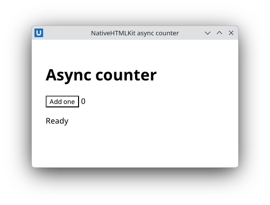 | [async_jobs](async_jobs.py)<br>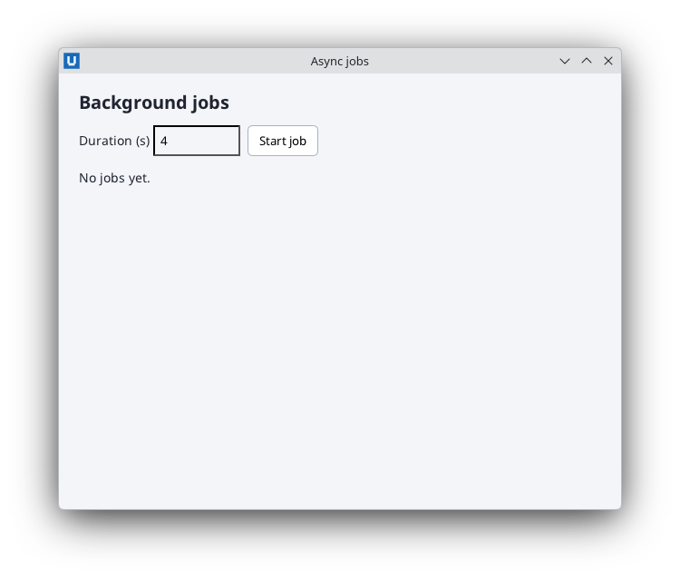 |
| [checksum](checksum.py)<br> | [data_table](data_table.py)<br>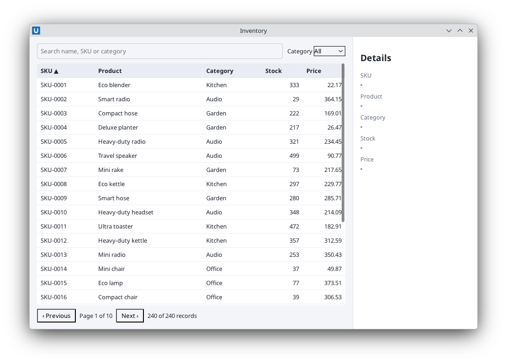 |
| [dom_explorer](dom_explorer.py)<br>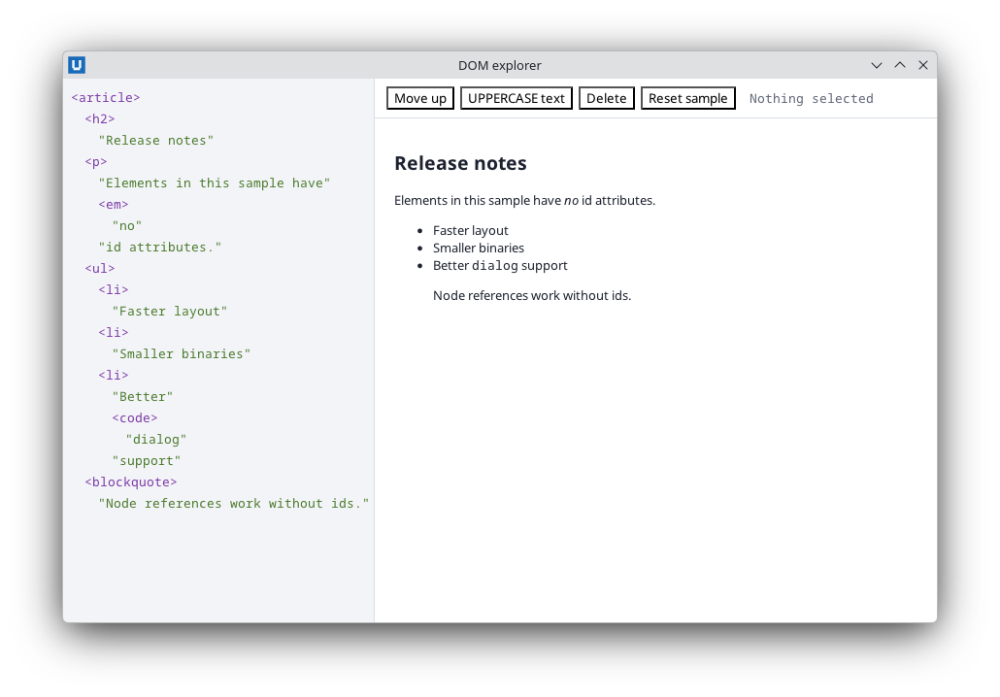 | [file_viewer](file_viewer.py)<br> |
| [focus_timer](focus_timer.py)<br>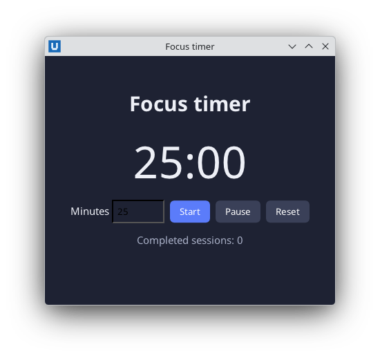 | [hello](hello.py)<br>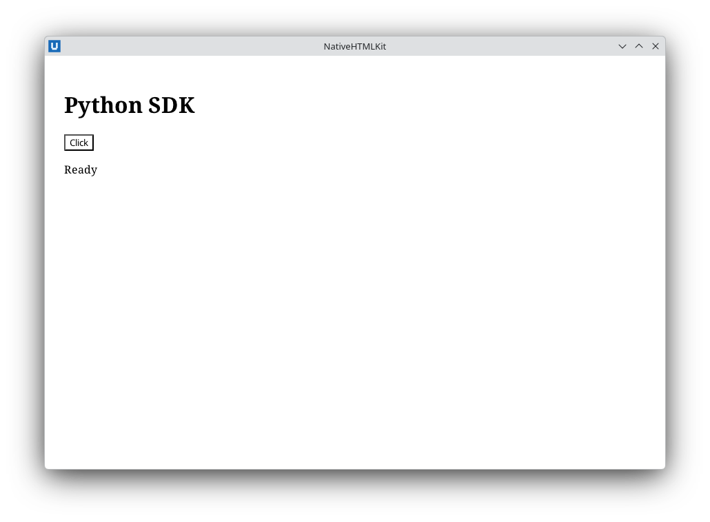 |
| [live_chart](live_chart.py)<br> | [log_viewer](log_viewer.py)<br>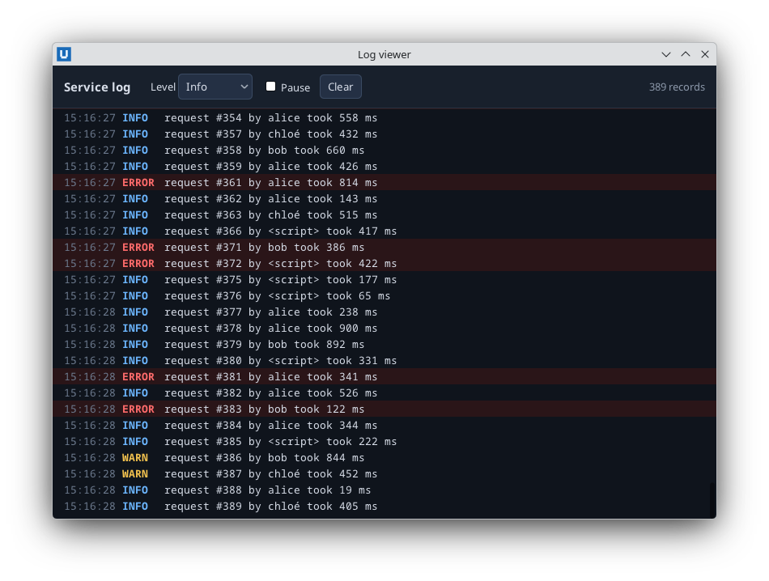 |
| [settings_dialog](settings_dialog.py)<br> | [signup_form](signup_form.py)<br>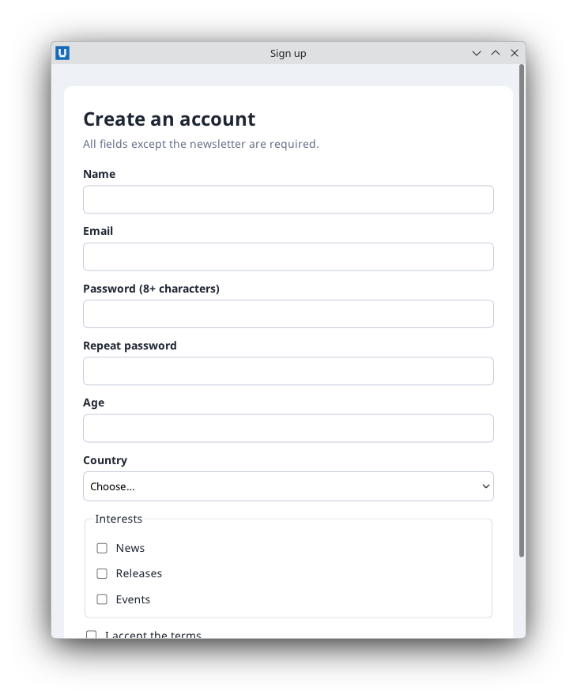 |
| [text_toolbox](text_toolbox.py)<br>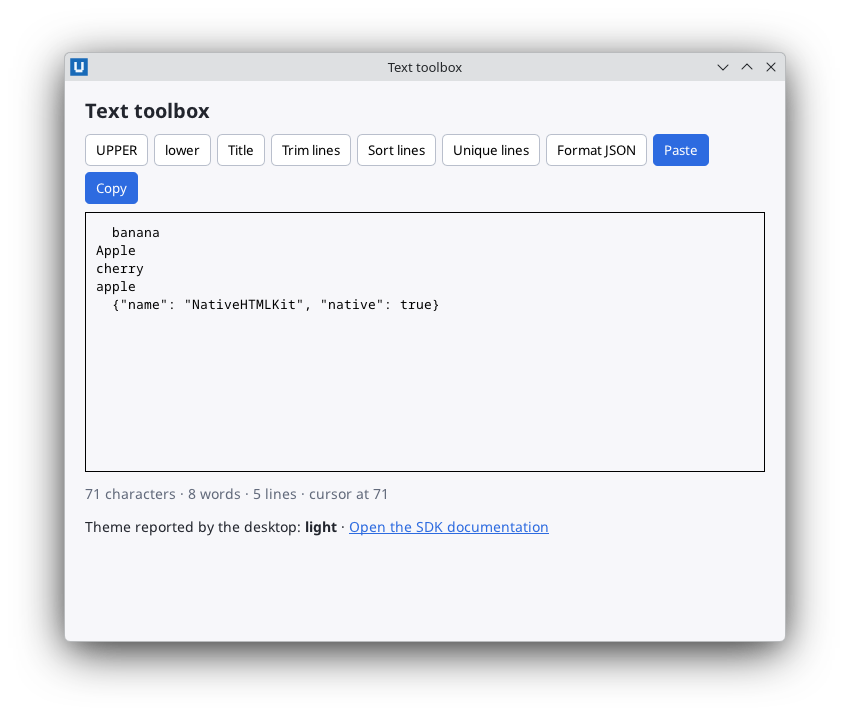 | [todo](todo.py)<br>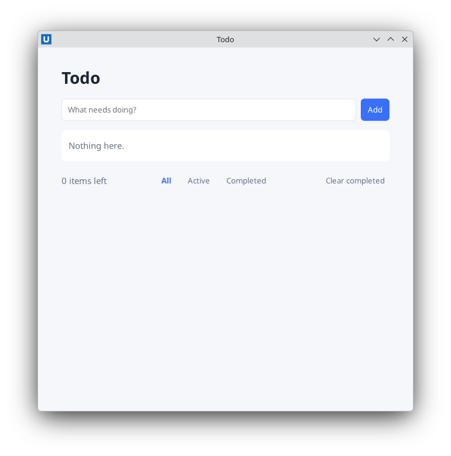 |
| [window_manager](window_manager.py)<br>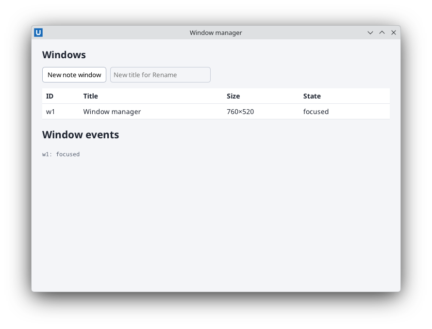 |  |
